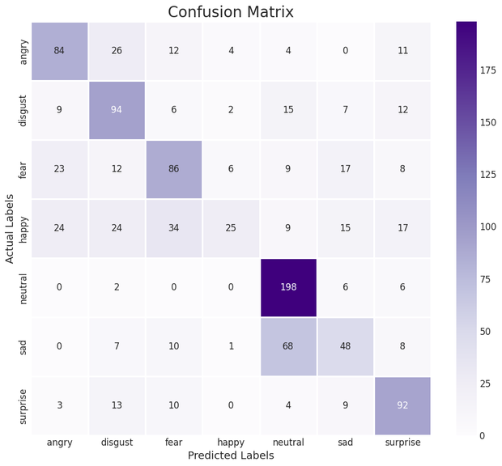

# Speech emotion recognition

A college project: classifying the emotion in short spoken sentences from the [RAVDESS](https://www.kaggle.com/datasets/uwrfkaggler/ravdess-emotional-speech-audio) dataset with a 1-D convolutional network over hand-made audio features.



## Result

| | |
|---|---|
| Accuracy | **58 %** over 7 classes (chance is about 14 %) |
| Data | 1,440 RAVDESS speech clips from 24 actors |
| Classes | angry, disgust, fear, happy, neutral (calm is counted as neutral), sad, surprise |

Neutral is recognised best and happy worst: happy clips are spread across almost every other class, and many sad clips are predicted as neutral.

**How to read the 58 %:** each clip was turned into three training examples (the original, a noisy copy and a pitch-shifted copy) *before* the random 75 / 25 split, so copies of the same recording can sit on both sides. That makes the score optimistic. A fair test would hold out whole actors.

## How it works

1. **Features** (Librosa), averaged over each clip: zero-crossing rate, chroma, MFCCs, RMS energy and mel spectrogram.
2. **Augmentation:** added noise, and a time-stretch plus pitch shift.
3. **Model** (Keras): stacked 1-D convolutions with batch normalisation, max pooling and dropout, then dense layers and a softmax over the classes.

## Run it

Open `Speech Emotion Recognition.ipynb`. It was run on Kaggle with the RAVDESS dataset attached; elsewhere, download the dataset and change the `RAV` path in the first data cell.

```bash
pip install librosa tensorflow scikit-learn seaborn pandas matplotlib
```
